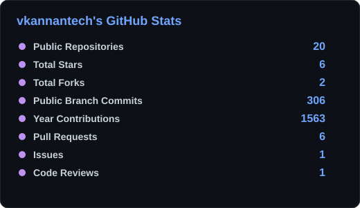
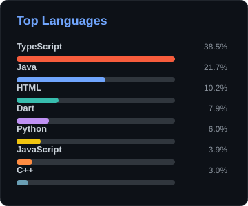
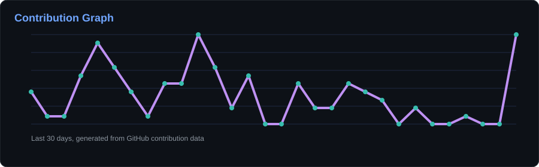

# Kannan V

### Backend brain. Full-stack hands.

**Full-Stack & Java Backend Developer · IT '28 · Founder, [KannanTech](https://www.kannantech.com)** 
Tirunelveli, Tamil Nadu, India

I design and ship web platforms end to end: database schema, REST APIs, auth, frontend and deployment.

## ⚡ Quick facts

| Topic | Details |
| --- | --- |
| **Roles I'm targeting** | Full-Stack Developer · Java Backend Developer · Software Engineer (SDE) Intern |
| **Availability** | Internships now · Full-time from 2028 · Anywhere in India or remote |
| **Core stack** | Java · Spring Boot · TypeScript · Next.js · React · Node.js · PostgreSQL · MySQL |
| **Strongest at** | REST API design, relational data modelling, full-stack product delivery |
| **Company** | KannanTech, MSME Udyam-registered Micro enterprise (`UDYAM-TN-18-0078156`) |

## 🚀 Featured projects

### FX Competency Portal · *flagship, in active development*
Skill-assessment platform for colleges: aptitude and coding exams with slot booking, results and placement tracking.
- Coding questions are auto-graded through a **Judge0** code-execution integration; exams run inside **Safe Exam Browser** lockdown to prevent cheating.
- Monorepo built with **Turborepo**: **Next.js 16** frontend, **Fastify** (Node.js) API, **PostgreSQL 18** database.
- `TypeScript` `Next.js` `Fastify` `PostgreSQL` `Turborepo` · *Source private (institutional project), walkthrough on request*

### [Library Management System API](https://github.com/vkannantech/library-management-system) · [Live API docs ↗](https://vkannantech.github.io/library-management-system/)
Backend REST API for managing books, members and loans.
- Built with **Java 25** and **Spring Boot 4.1**, using **Hibernate/JPA** over **MySQL**.
- Dynamic pagination, Bean Validation for request checking, and interactive **OpenAPI 3.1 / Swagger** documentation.
- `Java` `Spring Boot` `Hibernate` `MySQL` `REST API` `OpenAPI`

### [Internship Hub](https://intern.kannantech.com) · [Live ↗](https://intern.kannantech.com)
Internship management platform used to run KannanTech's intern cohorts.
- Task assignment and tracking, completion verification and progress analytics for mentors.
- `Next.js` `TypeScript` `Supabase` `PostgreSQL` `Tailwind CSS`

### [Networks Commands Deeply](https://github.com/vkannantech/Networks-Commands-Deeply)
Computer-networks toolkit: diagnostic CLI utilities (ping, tracert, netstat), socket programming, and
**Dijkstra** and **Bellman-Ford** routing simulations.
- `Java` `Socket Programming` `Data Structures & Algorithms` `Computer Networks`

<b>More projects</b>

 

| Project | What it is | Stack |
| --- | --- | --- |
| [Focus Edge](https://github.com/vkannantech/focus-edge-brave) | Auto-hiding toolbar and distraction-free mode for Chromium browsers | JavaScript · Chrome Extension (Manifest V3) |
| [Muzi](https://github.com/Muzi-Powered-by-KannanTech/Muzi) | Android music player with lyrics and metadata modules | Kotlin · C++ |
| [Currency Detection](https://github.com/vkannantech/Curency_Detection) | Image-based currency note recognition | Python · Computer Vision |

## 🧰 Technical skills

| Area | Skills |
| --- | --- |
| **Languages** | Java, TypeScript, JavaScript (ES6+), Python, Kotlin, Dart, SQL |
| **Backend** | Spring Boot, Hibernate / JPA, Node.js, Fastify, REST APIs, OpenAPI / Swagger |
| **Frontend** | React, Next.js, Tailwind CSS, HTML5, CSS3 |
| **Databases** | PostgreSQL, MySQL, Supabase |
| **Mobile** | Android (Kotlin), Flutter |
| **Tools & DevOps** | Git, GitHub Actions (CI/CD), Docker, Linux, Vercel, Turborepo |
| **CS fundamentals** | Data Structures & Algorithms, OOP, DBMS, Computer Networks |

## 👋 About me

**Kannan V** (Venkatesh Perumal Kannan, GitHub [@vkannantech](https://github.com/vkannantech)) is a full-stack and Java backend developer
from Tirunelveli, Tamil Nadu, India, and an Information Technology (IT) undergraduate graduating in 2028. He founded **KannanTech**, an
MSME Udyam-registered Micro enterprise ([verify](https://udyamregistration.gov.in/Udyam_Verify.aspx), `UDYAM-TN-18-0078156`) providing
software services and technical education since 2024, and teaches programming on the
[Kalvi World YouTube channel](https://www.youtube.com/@KalviWorldOfficial). He is open to software engineering internships and to full-time roles from 2028.

## 📈 GitHub activity

  
  

Last 30 days and recent activity

 

<!--START_SECTION:activity-->
<!--END_SECTION:activity-->

---

**Hiring for an internship or a full-stack / Java role?** Email [ceo@kannantech.com](mailto:ceo@kannantech.com?subject=Opportunity%20for%20Kannan%20V) or message me on [LinkedIn](https://www.linkedin.com/in/vkannantech).

